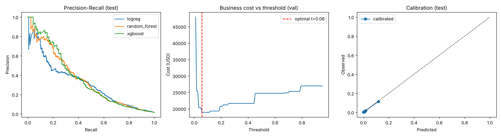
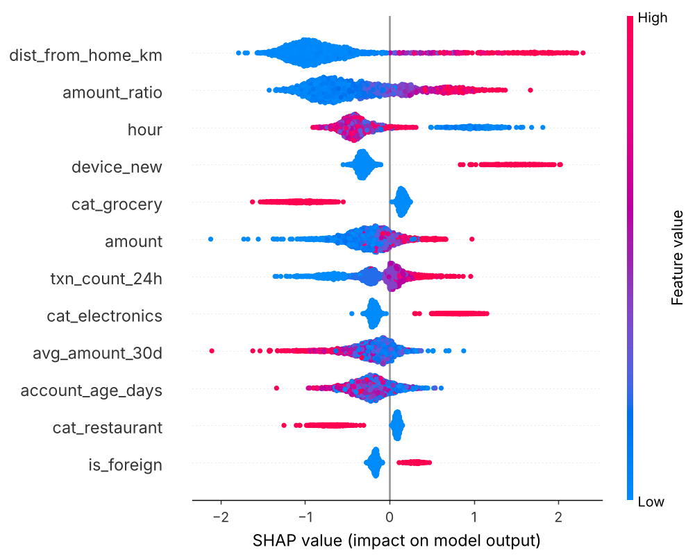

# FraudShield


**FraudShield is an end-to-end, cost-sensitive fraud-detection demonstration.** It generates realistic, reproducible transaction data, trains and compares machine-learning models, calibrates fraud probabilities, chooses an operational decision threshold from an explicit cost model, explains flagged transactions, monitors changes in incoming data, and serves predictions through a REST API.

The project is designed to show the parts of a practical machine-learning workflow that can get lost in a notebook: chronological evaluation, an explicit link between model scores and business decisions, consistent feature construction between training and serving, automated checks, and clear limitations. The data is synthetic, so the results are reproducible and contain no real cardholder information; they are an engineering demonstration, not a claim of production performance.

## What problem does it address?

Fraud detection is an imbalanced classification problem. In this simulation, only about **1.5%** of transactions are fraudulent. A system that approves every transaction could therefore appear more than 98% accurate while detecting no fraud at all. Accuracy alone does not describe the practical trade-off:

- **Missed fraud** creates a loss related to the transaction amount and a chargeback fee.
- **A legitimate transaction flagged as suspicious** takes time to review and may frustrate a customer.
- **A correctly flagged fraudulent transaction** still has a review cost.

FraudShield models these costs directly instead of treating every mistake as equally important. Its cost configuration is in [`src/fraudshield/config.py`](src/fraudshield/config.py), and the corresponding calculation and threshold search are in [`src/fraudshield/evaluate.py`](src/fraudshield/evaluate.py). A threshold is selected on validation data to minimize the configured simulated cost; it is not chosen by optimizing accuracy or F1.

## Project workflow

```text
Synthetic transactions
        │
        ▼
Chronological train / validation / test split
        │
        ├── Shared feature builder ──► Train and compare models on validation data
        │                                      │
        │                                      ▼
        │                         Select by validation PR-AUC
        │                                      │
        │                                      ▼
        │                         Calibrate probabilities (isotonic)
        │                                      │
        │                                      ▼
        │                         Minimize validation business cost
        │                                      │
        │                       ┌──────────────┴──────────────┐
        ▼                       ▼                             ▼
Evaluation plots       Saved model + metadata         Test-set evaluation
                              │
                   ┌──────────┴─────────┐
                   ▼                    ▼
             FastAPI scoring       SHAP explanations
                   │
                   ▼
         PSI + KS input-drift reports
```

### 1. Generate data and prevent temporal leakage

[`src/fraudshield/data.py`](src/fraudshield/data.py) creates 120,000 simulated transactions by default. It includes transaction amount, time of day, account age, merchant category, foreign and card-present indicators, transaction velocity, distance from home, typical account spend, and whether the device is new. Fraud likelihood is generated from a combination of these signals and interactions between them. The generator targets approximately 1.5% fraud and can produce a shifted batch to demonstrate drift.

Rows are split in chronological order into **70% training, 15% validation, and 15% test**. The validation set is used to compare models, calibrate the selected model, and choose its threshold. The test set is held out for final reporting; it is not used to select the model or operating threshold.

### 2. Compare models and choose an operating point

[`src/fraudshield/train.py`](src/fraudshield/train.py) compares logistic regression, a random forest, and XGBoost. It selects a model by validation **PR-AUC**, a useful ranking measure when positive examples are uncommon. After selection, it calibrates the model's probabilities with isotonic regression and searches for a threshold that minimizes the configured cost on validation data.

The current reported experiment selected XGBoost by PR-AUC. This is a deliberate ranking-based selection rule, not a claim that XGBoost wins on every business objective: the existing validation results show that logistic regression can save more simulated cost at its selected operating point. For a real deployment, model choice should be compared at the business operating point and should also account for latency, maintainability, interpretability, and operational constraints.

### 3. Explain decisions

[`src/fraudshield/explain.py`](src/fraudshield/explain.py) uses SHAP to produce a global feature-importance visualization and per-transaction reason codes. For a transaction that meets the block threshold, the API can return the top features pushing the prediction toward fraud, along with their values and contribution impacts. These are model explanations, not proof of causation or a substitute for policy and regulatory review.

### 4. Monitor input drift

[`src/fraudshield/drift.py`](src/fraudshield/drift.py) compares a current feature batch with the saved training reference using Population Stability Index (PSI) and the Kolmogorov–Smirnov statistic. It labels a feature `OK`, `WATCH`, or `RETRAIN` based on PSI thresholds:

| PSI | Status | Interpretation in this demo |
|---:|---|---|
| Below 0.10 | `OK` | No material shift indicated by this rule |
| 0.10 to 0.25 | `WATCH` | Review the feature and incoming data |
| Above 0.25 | `RETRAIN` | Investigate and consider retraining |

These are monitoring heuristics, not an automatic retraining policy. Input drift alone does not establish that model performance has degraded; measuring performance also requires reliable, matured labels.

### 5. Serve predictions

[`src/fraudshield/api.py`](src/fraudshield/api.py) exposes a FastAPI service with:

- `GET /health` — service and loaded-model status
- `GET /model-info` — model name, decision threshold, and test metrics
- `POST /predict` — validated transaction input, fraud probability, decision, threshold, latency, and (for blocked transactions) reason codes
- `GET /docs` — interactive Swagger UI generated by FastAPI

The API loads the trained model and metadata at startup. Train the model first when running the API directly; the Docker image trains a model during its build.

## Results

The figures below are the project's recorded synthetic-data experiment. Results are illustrative and depend on the generated dataset, configured costs, and training environment. They should not be interpreted as measured performance on real financial transactions.

### Model comparison on validation data

| Model | PR-AUC | ROC-AUC | Simulated cost savings |
|---|---:|---:|---:|
| Logistic regression | 0.311 | **0.915** | **43.7%** |
| Random forest | 0.343 | 0.898 | 39.1% |
| **XGBoost (selected by PR-AUC)** | **0.358** | 0.898 | 36.9% |

### Selected model on the held-out test set

| Metric | Recorded result |
|---|---:|
| ROC-AUC | 0.889 |
| PR-AUC | 0.324 |
| Precision at the cost-selected threshold | 0.225 |
| Recall at the cost-selected threshold | 0.543 |
| Alert rate | 3.8% |
| Decision threshold | approximately 0.056 |
| Simulated cost, approve-all baseline | $30,585 |
| Simulated cost, with model | $18,283 |
| Simulated cost reduction | 40.2% (approximately $12,300) |

The experiment uses a test set of approximately 18,000 transactions. Since the dataset is synthetic and the cost assumptions are configurable, the savings figure demonstrates how the decision rule behaves under this simulation; it is not a forecast or guarantee of real-world savings.

### Evaluation and explanation artifacts





The generated drift examples are available as [`reports/drift_stable.csv`](reports/drift_stable.csv) and [`reports/drift_drifted.csv`](reports/drift_drifted.csv).

## Quick start

### Requirements

- Python 3.11 or newer
- pip
- Docker only if you want to run the containerized service

### Install and run the complete workflow

From the repository root:

```bash
python -m venv .venv
```

Activate the environment, then install dependencies and run the workflow:

```bash
# Windows PowerShell
.\.venv\Scripts\Activate.ps1

# macOS / Linux
source .venv/bin/activate

python -m pip install -r requirements.txt
make all
```

`make all` trains and evaluates the models, creates the SHAP and drift artifacts, and runs the test suite. On Windows, `make` is available through GNU Make (for example, in Git Bash or a development environment that provides it). The individual Python modules can also be run without Make:

```bash
$env:PYTHONPATH = "src"                         # Windows PowerShell
python -m fraudshield.train
python -m fraudshield.explain
python -m fraudshield.drift
python -m pytest -q
```

For macOS/Linux shells, set the source path with `export PYTHONPATH=src` before running those commands.

### Start the API

After training, start the local service:

```bash
# With PYTHONPATH=src
uvicorn fraudshield.api:app --reload
```

Open [http://localhost:8000/docs](http://localhost:8000/docs) for the interactive API documentation.

Example request:

```bash
curl -X POST "http://localhost:8000/predict" \
  -H "Content-Type: application/json" \
  -d '{
    "amount": 900,
    "hour": 3,
    "account_age_days": 5,
    "merchant_category": "electronics",
    "is_foreign": 1,
    "card_present": 0,
    "txn_count_24h": 9,
    "dist_from_home_km": 3000,
    "avg_amount_30d": 30,
    "device_new": 1
  }'
```

The response includes fields in this shape; probability, threshold, reasons, and latency are produced by the running model and can differ:

```json
{
  "fraud_probability": 0.99,
  "decision": "BLOCK",
  "threshold": 0.0563,
  "reasons": [
    {"feature": "device_new", "value": 1, "impact": 1.084},
    {"feature": "new_account", "value": 1, "impact": 1.034},
    {"feature": "foreign_cnp", "value": 1, "impact": 0.95}
  ],
  "latency_ms": 19.9
}
```

### Run with Docker

Docker builds an image, installs the dependencies, and trains the model during image construction. The container then serves the API on port 8000:

```bash
docker build -t fraudshield .
docker run --rm -p 8000:8000 fraudshield
```

Or, if GNU Make is installed:

```bash
make docker
```

## Repository layout

```text
src/fraudshield/
  config.py       Cost assumptions, paths, and random seed
  data.py         Synthetic transaction generation and chronological splitting
  features.py     Shared feature construction for training and serving
  evaluate.py     Cost calculation, threshold search, and metrics
  train.py        Model comparison, calibration, evaluation, and persistence
  explain.py      SHAP global explanations and transaction reason codes
  drift.py        PSI/KS drift analysis and report generation
  api.py          FastAPI health, model-information, and prediction endpoints
tests/
  test_core.py    Core data, evaluation, and drift behavior
  test_api.py     API behavior
reports/
  evaluation.png  Recorded evaluation plots
  shap_summary.png Recorded SHAP summary
  drift_*.csv      Recorded stable and shifted-data drift examples
models/
  metadata.json   Recorded experiment metadata
  .gitkeep        Keeps the model output directory in Git
.github/workflows/ci.yml
Dockerfile
Makefile
requirements.txt
INTERVIEW_GUIDE.md
```

Newly trained model binaries and generated reference data are intentionally ignored by Git; run the training workflow to create local artifacts.

## Testing and continuous integration

Run the unit and API tests with:

```bash
PYTHONPATH=src pytest -q
```

The GitHub Actions workflow in [`.github/workflows/ci.yml`](.github/workflows/ci.yml) installs the dependencies, runs training, and then runs the tests on Python 3.11 for pushes and pull requests. Running training before the tests also ensures the API tests have a model and metadata available.

## Design choices

- **Chronological split:** evaluation follows time order rather than randomly mixing transactions from different periods.
- **Cost-aware decisions:** threshold selection makes false negatives, false positives, and reviewed true positives have distinct configured costs.
- **Probability calibration:** isotonic calibration makes the threshold operate on calibrated scores, subject to the limitations of validation data and synthetic labels.
- **Rare-event metrics:** PR-AUC, precision, recall, and alert rate complement ROC-AUC for an imbalanced dataset.
- **Shared feature builder:** training and serving call the same feature transformation code to reduce train/serve skew.
- **Reproducibility:** the generated data uses a fixed random seed and has no external data-download step.
- **Observable outputs:** training writes model metadata and evaluation artifacts; drift analysis writes CSV reports.

## Limitations and responsible use

- **Synthetic data only.** Fraud patterns and labels are generated by code, not learned from representative real-world transaction records. The recorded metrics do not establish effectiveness on real transactions.
- **Illustrative costs.** The USD cost values are assumptions for a demonstration. A real decision system needs costs estimated and approved by the relevant business, risk, and compliance stakeholders.
- **No production controls.** This project is not a payment processor or production fraud service. It does not include authentication, authorization, privacy controls for real transaction data, rate limiting, durable event logging, model approval, rollback, or high-availability deployment.
- **Explanation caveats.** SHAP reason codes describe how the model behaves; they do not prove why a transaction is fraudulent, and they should not be treated as an automatic adverse-action explanation without domain and legal review.
- **Drift is not model quality.** PSI and KS describe distribution changes. They do not measure false-positive rates, missed fraud, fairness, or other outcomes, especially before labels mature.
- **No fairness or subgroup analysis.** The simulation is not an assessment of disparate impact or suitability for consequential decisions.

Do not use the generated model or example threshold to approve, block, or otherwise make decisions about real people or payments. Real-world use would require representative data, rigorous validation, security and privacy controls, domain oversight, and applicable legal and regulatory review.

## Possible next steps

- Evaluate against a documented real-world benchmark with appropriate data governance.
- Add delayed-label handling and monitor predictive performance as labels mature.
- Compare candidate models at agreed business operating points, including latency and review capacity.
- Add experiment tracking and principled hyperparameter search.
- Add model versioning, shadow deployment, rollback, and operational alerting.
- Evaluate subgroup performance, calibration, and fairness with domain and legal review.

## License

FraudShield is distributed under the [MIT License](LICENSE).
